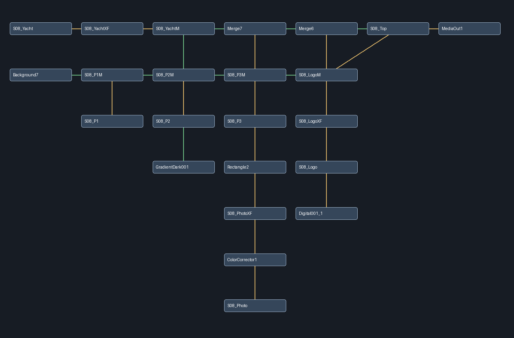

# NodeAlign

**Auto-layout for Fusion node flows** — a Lua script for DaVinci Resolve (Fusion page) and Fusion Studio that tidies up messy node graphs with a single click, without destroying your logic.



## Why

Fusion does not ship any "organize nodes" command. After a few days of work, comps turn into a spaghetti of crossed wires and stacked tiles. Existing community scripts either flip everything into a vertical tower or ignore real-world comps (Macros, Groups, MediaOut chains).

NodeAlign takes the opposite approach: it works **backwards from the sink**, preserving what you actually look at — the image path — and folding only what is safe to fold.

## How it works

1. The graph is split into **connected components** (independent branches), placed side by side — no overlaps.
2. For each component, the **sinks** (nodes with no downstream output, e.g. `MediaOut`) keep their Y position and anchor the component in X.
3. A dominant **image backbone** is traced upstream to the sink (through Foreground inputs too, ignoring masks) and kept strictly horizontal.
4. Only **linear accessory chains** fold vertically (max 4 nodes), never Merges, junctions, fan-outs or the backbone.
5. Sideways branches get their own rows; **Macro/Group nodes are treated as atomic** (connections are projected onto the top-level tool, fixing the classic "lost connection" bug with `GetConnectedOutput():GetTool()`).

Spacing: `PITCH_X = 1.1`, row step `1.75` — tuned on real production comps.

## Menu entries

The script adds three entries under **Workspace → Scripts (or the Fusion menu, depending on install)**:

| Entry | Action |
|---|---|
| **NodeAlign: All** | Lays out every tool in the comp |
| **NodeAlign: Selected Tree** | Lays out only the upstream tree of the selected nodes |
| **NodeAlign: Fix Overlaps** | Keeps the current layout, only nudges overlapping tiles apart |

Every operation creates a **dedicated undo step**, so `Ctrl+Z` fully reverts it.

## Installation

### DaVinci Resolve
Copy `NodeAlign.lua` to:

- **Windows:** `%APPDATA%\Blackmagic Design\DaVinci Resolve\Support\Fusion\Scripts\Comp\`
- **macOS:** `~/Library/Application Support/Blackmagic Design/DaVinci Resolve Support/Fusion/Scripts/Comp/`
- **Linux:** `~/.local/share/DaVinciResolve/Fusion/Scripts/Comp/`

Then open a Fusion page in Resolve and run it from the **Workspace → Scripts** menu.

### Fusion Studio
Copy `NodeAlign.lua` to `Scripts/Comp/` inside the Fusion Studio settings folder (`Fusion → Script → ...`), or install it via **Reactor** by pointing your `Reactor:/` path at this folder.

## Testing

The `tests/` folder contains a self-contained Lua test suite (no Resolve required) plus a comp fixture in JSON:

```bash
lua tests/test_nodealign.lua
# 26/26 tests pass on Lua 5.1 and Lua 5.4
```

`tests/render_preview.py` renders a layout JSON to PNG (requires Pillow) so you can eyeball results without opening Resolve:

```bash
python tests/render_preview.py tests/fixtures/resolve-s08.json preview.png
```

## Compatibility

- DaVinci Resolve 18+ (Fusion page), Fusion Studio 18+
- Lua 5.1 (Resolve's embedded Lua) and Lua 5.4
- Works with Macros, Groups, Masks, 3D and Particle tools

## License

[MIT](LICENSE) — free to use, modify and redistribute. If it saves you an afternoon, consider starring the repo.
